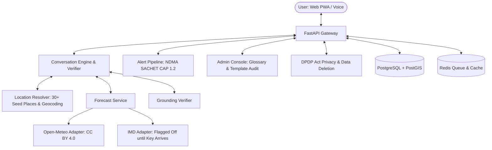

# WeatherGPT 🌦️

A grounded, multilingual, voice-first weather assistant for India.
A non-commercial, public-interest pilot delivered as a progressive web app (PWA) with no native app dependencies.

The LLM explains. Tools supply facts. Official warnings are relayed as issued.

---

## 🏛️ Architecture & The Authority Ladder

Every number in WeatherGPT is backed by an **evidence packet** (source, authority tier, issue time, validity window, place, units, uncertainty, and attribution).
Answers strictly follow the **Authority Ladder**:

```
Official Warning (Tier 1: IMD / NDMA SACHET)
       ▲
Official Forecast (Tier 2: IMD City / District)
       ▲
National Model (Tier 3: NCMRWF / IITM)
       ▲
Global Model Guidance (Tier 4: ECMWF IFS / NOAA GFS)
       ▲
Aggregator / Fallback (Tier 5: Open-Meteo)
```

The LLM narrates and translates; **it adds no facts**. If the grounding verifier detects an ungrounded number or hallucination, it immediately falls back to a deterministic template constructed directly from the evidence packets.



---

## 🚀 Quick Start

### Prerequisites
- Python 3.12+
- Git
- Docker Desktop or Docker Engine
- Node.js 18+ (for Web frontend build)

### 1. Verify Prerequisites
```bash
python scripts/dev.py doctor
```

### 2. Run Test Suite
```bash
python scripts/dev.py test
```

### 3. Run Lint & Static Analysis
```bash
python scripts/dev.py lint
```

### 4. Run Golden-Set Evaluations
```bash
# English golden set (30 cases)
python scripts/dev.py eval --lang en

# Hindi golden set (300 cases across 30+ Indian cities)
python scripts/dev.py eval --lang hi
```

### 5. Run Full Acceptance Gates
```bash
python scripts/dev.py acceptance
```

### 6. Interactive Scripted Demo
```bash
python scripts/dev.py demo
```

---

## 📁 Repository Structure
```
├── apps/
│   └── web/                   # React 18 + TypeScript + Tailwind CSS PWA
├── config/
│   ├── models.yaml            # Groq & OpenRouter model selection configs
│   ├── sources.yaml           # External data sources & authority tiers
│   └── languages.yaml         # Multilingual tier configurations
├── deploy/                    # Production deployment pack (Compose + Caddy TLS)
├── docs/
│   ├── architecture.md        # Architectural decisions and data flows
│   ├── runbook.md             # Operator runbook (restarts, outages, backups)
│   ├── privacy-dpdp.md        # DPDP Act 2023 compliance checklist
│   └── accessibility-audit.md # WCAG 2.2 AA audit
├── eval/
│   ├── golden/                # Golden test sets (en/ and hi/)
│   ├── fixtures/              # Recorded test fixtures (Open-Meteo, SACHET, IMD)
│   └── results/               # Acceptance reports and evaluation outputs
├── infra/
│   └── k8s/                   # Kubernetes manifests & Blue-Green deployment strategy
├── packages/
│   └── contracts/             # Shared JSON Schemas & OpenAPI specifications
├── seeds/                     # Vetted seeds: glossaries, uncertainty, alert templates
├── services/
│   └── api/                   # FastAPI backend, modules, adapters, conversation core
└── scripts/
    ├── dev.py                 # Cross-platform developer CLI runner
    └── tasks/                 # Individual task scripts
```

---

## 📜 Licences & Non-Commercial Notice
WeatherGPT is a non-commercial, public-interest research pilot. It contains no advertisements, paid subscription tiers, or resale of source weather data.

All data sources are properly attributed:
- **Open-Meteo**: Creative Commons Attribution 4.0 International (CC BY 4.0)
- **NDMA SACHET**: National Disaster Management Authority, Government of India (Open CAP 1.2 Feed)
- **ECMWF Open Data**: CC BY 4.0
- **OpenStreetMap**: Open Data Commons Open Database License (ODbL)
